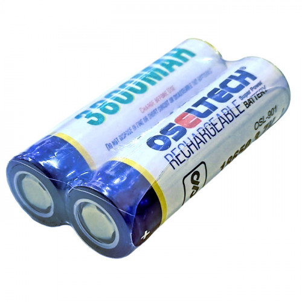

# OselTech 18650 Li-Ion Power System

Master-Mouse utilizes high-capacity **OselTech 18650** lithium-ion rechargeable cells to supply regulated power to the microcontroller logic and high-drain DC gear motors during autonomous maze runs.

## Phase 1: Cell Architecture & Specifications

The primary energy storage unit operates on a standard cylindrical $18\text{ mm} \times 65\text{ mm}$ form factor with a flat-top terminal configuration.

### 1. Electrical & Physical Parameters

* **Brand:** OselTech
* **Chemistry & Form Factor:** $18650$ Lithium-Ion (Li-Ion)
* **Nominal Capacity:** $3800\text{ mAh}$
* **Voltage Profile:**
  $$\text{Nominal} = 3.7\text{ V}, \quad V_{\text{max}} = 4.2\text{ V}, \quad V_{\text{cutoff}} = 3.0\text{ V}$$
* **Terminal Configuration:** Flat Top
* **Cycle Life:** Up to $1000$ charge-discharge cycles
* **Operating Temperature Range:** $-20^\circ\text{C}$ to $+85^\circ\text{C}$

## Phase 2: Safety & Power Management

Because the OselTech $18650$ is an **unprotected cell** (lacking an internal Battery Management System), external hardware and firmware safeguards are enforced:

1. **Over-Discharge Protection:** Voltage must never drop below $3.0\text{ V}$ under load; firmware ADC monitoring triggers a low-voltage cutoff at $3.2\text{ V}$.
2. **Charging Regulation:** Cells require a dedicated constant-current/constant-voltage ($\text{CC/CV}$) charger terminating strictly at $4.2\text{ V}$.
3. **Thermal & Short-Circuit Isolation:** External BMS circuitry isolates the power rail against peak stall currents from the drive motors.

---

## Component Visual Reference

