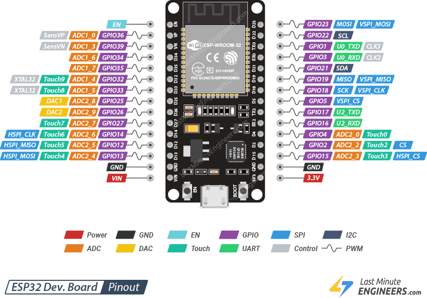

# ESP32-S3-WROOM-1 Microcontroller Unit

Master-Mouse utilizes the **ESP32-S3-WROOM-1** dual-core microcontroller development board as the central processing unit for real-time Flood-Fill pathfinding, high-speed sensor polling, and closed-loop PID motor control.

## Phase 1: Processor & Memory Architecture

The module is built around the Xtensa® 32-bit LX7 dual-core processor, enabling parallel execution of maze-solving logic on Core 0 and high-frequency motor/encoder control loops on Core 1.

### 1. Core Technical Specifications

* **Microcontroller SoC:** ESP32-S3 (Xtensa® Dual-Core 32-bit LX7)
* **Clock Frequency:** Up to $240\text{ MHz}$
* **Memory Architecture:**
  $$\text{SRAM} = 512\text{ KB}, \quad \text{ROM} = 384\text{ KB}, \quad \text{Flash} = 8\text{ MB / }16\text{ MB (SPI)}$$
* **Operating Logic Voltage:** $3.3\text{ V}$ (Input power via $5\text{ V}$ USB-C or $\text{VIN}$ pin)
* **USB Interface:** Dual USB Type-C (Native USB-OTG + UART Bridge)
* **Wireless Connectivity:** $2.4\text{ GHz}$ Wi-Fi ($802.11\text{ b/g/n}$) & Bluetooth® 5 (LE) for wireless telemetry

## Phase 2: Peripheral & I/O Allocation

The ESP32-S3 provides flexible GPIO multiplexing for reading wall sensors, quadrature wheel encoders, and generating PWM signals for the motor driver:

1. **GPIO Capacity:** Up to $45$ programmable GPIOs supporting $\text{I}^2\text{C}$, $\text{SPI}$, $\text{UART}$, and $\text{MCPWM}$.
2. **Analog-to-Digital Conversion (ADC):** Two $12\text{-bit}$ SAR ADCs ($20$ channels total) used for analog infrared distance sensing and battery voltage monitoring.
3. **Hardware Timers & Interrupts:** Dedicated hardware pulse counters ($\text{PCNT}$) and external pin interrupts track quadrature encoder ticks without CPU polling overhead.

---

## Component Visual & Pinout Reference

