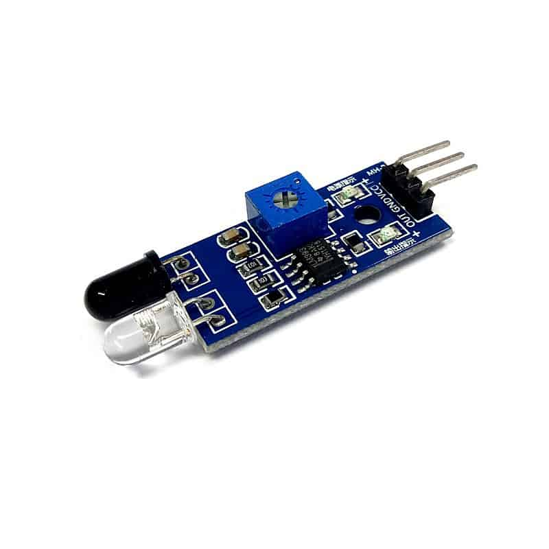

# Flying Fish IR Obstacle & Proximity Sensor Module

Master-Mouse utilizes the **Flying Fish IR** active infrared sensor module for real-time maze wall detection and proximity sensing. The module pairs an active infrared emitter with a photodiode receiver, processed through an onboard **LM393** voltage comparator.

## Phase 1: Sensor Architecture & Specifications

The sensor emits an infrared beam and measures the reflected intensity from nearby maze walls, comparing the photodiode voltage against a threshold set by the onboard multi-turn potentiometer.

### 1. Electrical & Physical Parameters

* **Comparator IC:** LM393 Dual Differential Comparator
* **Operating Voltage:** $3.3\text{ V}$ to $5.0\text{ V DC}$
* **Operating Current:** $\approx 20\text{ mA}$
* **Detection Range:** $2\text{ cm}$ to $30\text{ cm}$ (calibrated via onboard potentiometer)
* **Effective Detection Angle:** $35^\circ$
* **Physical Dimensions:** $45\text{ mm} \times 13\text{ mm} \times 8\text{ mm}$
* **Output Logic:** Digital Active-LOW

$$\text{OUT} = \begin{cases} 0\text{ (LOW)}, & \text{if wall/obstacle detected} \\ 1\text{ (HIGH)}, & \text{if path is clear} \end{cases}$$

## Phase 2: Pin Configuration & Onboard Diagnostics

### 1. Interface Pinout

| Pin | Function | Description |
| :--- | :--- | :--- |
| **VCC** | Power Supply | $3.3\text{ V} - 5\text{ V}$ regulated DC input |
| **GND** | Ground | Common system ground reference |
| **OUT** | Digital Output | Connects to ESP32-S3 GPIO (pulls `LOW` upon wall detection) |

### 2. Onboard Indicators & Controls

1. **Power LED:** Illuminates continuously when $3.3\text{ V}/5\text{ V}$ power is applied to the module.
2. **Obstacle / Status LED:** Illuminates when reflected IR light exceeds the comparator threshold (wall detected within range).
3. **Sensitivity Potentiometer:** Adjusts the comparator reference voltage to calibrate the exact trigger distance for $18\text{ cm} \times 18\text{ cm}$ maze cells.

---

## Component Visual Reference

