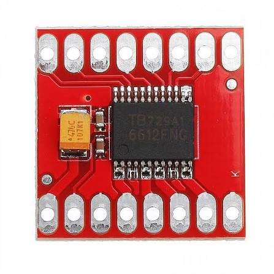

# TB6612FNG Dual H-Bridge DC Motor Driver

Master-Mouse utilizes the **TB6612FNG** dual MOSFET-based H-bridge driver IC to independently control the speed and direction of the left and right N20 DC gear motors. Unlike older BJT-based drivers (such as the L298N), its low-on-resistanceLDMOS output transistors minimize voltage drop and thermal dissipation during high-speed maze traversal.

## Phase 1: Electrical & Thermal Specifications

The module separates the low-voltage microcontroller logic rail from the high-current motor power supply rail, supporting high-frequency PWM speed modulation.

### 1. Core Operating Parameters

* **Driver IC:** Toshiba TB6612FNG (Dual H-Bridge MOSFET Driver)
* **Motor Supply Voltage ($\text{VM}$):** $4.5\text{ V}$ to $13.5\text{ V DC}$ (up to $15\text{ V}$ absolute max)
* **Logic Supply Voltage ($\text{VCC}$):** $2.7\text{ V}$ to $5.5\text{ V DC}$ ($3.3\text{ V}$ compatible with ESP32-S3)
* **Output Current Capacity:**

$$I_{\text{continuous}} = 1.2\text{ A per channel}, \quad I_{\text{peak}} = 3.2\text{ A per channel}$$

* **Maximum PWM Switching Frequency:** $100\text{ kHz}$
* **On-Resistance ($R_{\text{DS(on)}}$):** $\approx 0.5\text{ }\Omega$ (combined upper and lower MOSFETs)
* **Built-in Protection:** Thermal shutdown ($\text{TSD}$), under-voltage lockout ($\text{UVLO}$), and integrated flyback diodes

## Phase 2: Control Logic & Pin Configuration

Each motor channel ($\text{A}$ and $\text{B}$) is governed by two digital direction pins ($\text{IN1}$, $\text{IN2}$) and one pulse-width modulation input ($\text{PWM}$), alongside a global hardware standby pin ($\text{STBY}$).

### 1. H-Bridge Control Truth Table

| IN1 | IN2 | PWM | STBY | Motor Output Mode |
| :---: | :---: | :---: | :---: | :--- |
| `H` | `H` | `H/L` | `H` | **Short Brake** (Rapid deceleration) |
| `L` | `H` | `H` | `H` | **Counter-Clockwise (CCW)** at PWM duty cycle |
| `H` | `L` | `H` | `H` | **Clockwise (CW)** at PWM duty cycle |
| `L` | `L` | `H` | `H` | **Stop** (High-impedance coast) |
| `X` | `X` | `X` | `L` | **Standby** (Driver disabled, low-power state) |

### 2. Interface Pinout Summary

1. **Power Pins ($\text{VM}$, $\text{VCC}$, $\text{GND}$):** $\text{VM}$ connects to the $2\text{S}$ $18650$ battery rail ($7.4\text{ V}$ nominal); $\text{VCC}$ connects to the ESP32-S3 $3.3\text{ V}$ logic rail.
2. **Control Inputs ($\text{AIN1/AIN2}$, $\text{BIN1/BIN2}$, $\text{PWMA/PWMB}$):** Connected to ESP32-S3 GPIOs for directional switching and closed-loop PID speed control.
3. **Motor Outputs ($\text{AO1/AO2}$, $\text{BO1/BO2}$):** Directly drive the left and right DC gear motor terminals.

---

## Component Visual Reference

