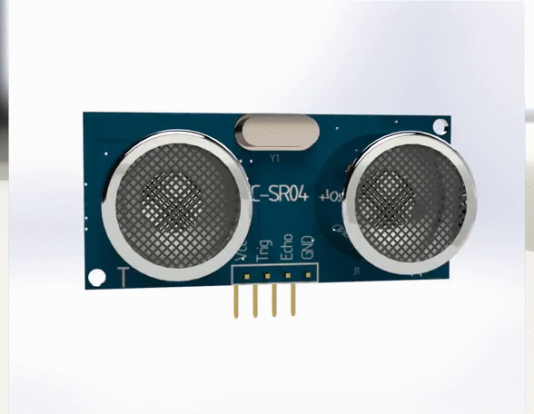

# HC-SR04 Ultrasonic Distance & Proximity Sensor

Master-Mouse utilizes the **HC-SR04** non-contact ultrasonic ranging module to measure forward corridor clearance and wall distance with millimeter precision using $40\text{ kHz}$ acoustic pulses.

## Phase 1: Acoustic Ranging & Specifications

The sensor emits an $8\text{-cycle}$ burst of ultrasound at $40\text{ kHz}$ upon triggering and listens for the reflected wave off maze walls. The distance $d$ is calculated from the round-trip time-of-flight ($t_{\text{echo}}$) and the speed of sound in air ($v_s \approx 343\text{ m/s}$ or $0.0343\text{ cm/}\mu\text{s}$):

$$d = \frac{v_s \cdot t_{\text{echo}}}{2} = \frac{0.0343 \cdot t_{\text{echo}}}{2}\text{ cm}$$

### 1. Electrical & Acoustic Parameters

* **Operating Voltage:** $5.0\text{ V DC}$ (newer revisions support $3.3\text{ V}$ logic)
* **Operating Current:** $15\text{ mA}$
* **Acoustic Operating Frequency:** $40\text{ kHz}$
* **Measurement Range:** $2\text{ cm}$ to $400\text{ cm}$ (up to $4.5\text{ m}$ depending on revision)
* **Ranging Accuracy:** $\pm 3.0\text{ mm}$
* **Effective Cone Angle:** $15^\circ$ to $30^\circ$

## Phase 2: Pin Configuration & Timing Protocol

### 1. 4-Pin Interface

| Pin | Direction | Description |
| :--- | :---: | :--- |
| **VCC** | Power | Connects to regulated $5\text{ V DC}$ supply rail |
| **Trig** | Input | Receives a $10\text{ }\mu\text{s}$ `HIGH` TTL pulse from ESP32-S3 to initiate ranging |
| **Echo** | Output | Outputs a `HIGH` pulse whose width equals the acoustic time-of-flight ($t_{\text{echo}}$) |
| **GND** | Ground | Common system ground reference |

### 2. Ranging Sequence

1. **Trigger Pulse:** Pull the `Trig` pin `HIGH` for at least $10\text{ }\mu\text{s}$, then return it `LOW`.
2. **Acoustic Burst:** The transmitter automatically sends eight $40\text{ kHz}$ square-wave ultrasonic pulses.
3. **Echo Capture:** The `Echo` pin transitions `HIGH` until the reflected wave returns, allowing the microcontroller hardware timer/interrupt

3. **Echo Capture:** The `Echo` pin transitions `HIGH` until the reflected wave returns, allowing the microcontroller hardware timer/interrupt to measure the exact pulse width in microseconds.

---

## Component Visual Reference

